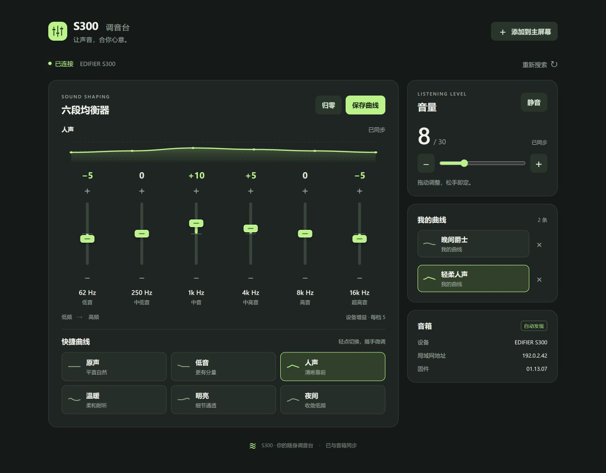
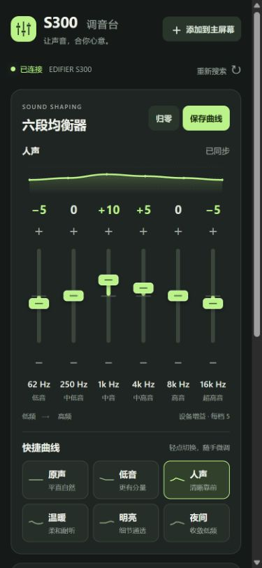
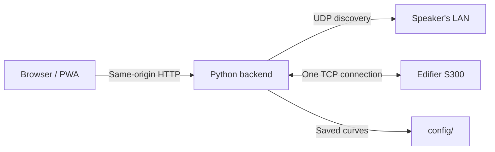

<div align="center">


**A small, self-hosted control room for your Edifier S300.**

[](pyproject.toml)
[](LICENSE)
[](#install-on-your-phone)
[](pyproject.toml)

[Quick start](#quick-start) · [Screenshots](#a-familiar-place-for-your-sound) · [Configuration](docs/configuration.md) · [Protocol](docs/protocol.md)

English · [简体中文](README.zh-CN.md)

</div>

---

S300 Control brings the speaker's six-band equalizer to a compact web interface. Drag a band, tap a preset, or save a curve you want to hear again. The backend discovers speakers on its own LAN and verifies every setting by reading it back from the device.

There is no frontend build step, account, cloud relay, or runtime package dependency. The UI is currently in Simplified Chinese; both documentation languages cover the same setup.

## A familiar place for your sound



<details>
<summary><strong>See the mobile layout</strong></summary>
<br>

</details>

*Screenshots use a synthetic speaker and example addresses. No personal device data is included.*

## What you get

| | |
| :--- | :--- |
| **Six bands, one clear view** | 62 Hz to 16 kHz, with drag, step buttons, keyboard controls, and a live curve. |
| **Quick curves and your own collection** | Six built-in DIY curves; save custom curves and share them across your browsers through the backend. |
| **Finds its own speaker** | UDP discovery, stable device identity, and automatic reconnection when an address changes. |
| **Settings you can trust** | One persistent TCP connection, serialized writes, and a fresh device readback after each setting. |
| **Fits a phone** | Responsive layout, safe-area support, an installable PWA, and lossless app icons up to 1024 px. |
| **Easy to host** | Python standard library at runtime, Docker host networking, a read-only image, and a small configuration directory. |

The speaker supports gains from **−30 to +30 in steps of 5**. These are device gain units; the physical dB conversion has not been established. Quick curves are this project's DIY combinations, not official factory sound modes.

## Quick start

Use a **Linux Docker host on the speaker's LAN**. Host networking lets the backend receive LAN discovery replies. No speaker IP is required.

From a checkout of this repository:

```sh
mkdir -p config
cp examples/settings.json config/settings.json
docker compose -f devlop/compose.yaml up -d --build
```

Open **`http://<your-server>:18730/`**. The backend will discover the speaker automatically. Check progress with:

```sh
docker compose -f devlop/compose.yaml ps
docker compose -f devlop/compose.yaml logs --tail=50 s300
```

The container runs as UID/GID 1000 by default. If your checkout belongs to another user, set `S300_UID` and `S300_GID` to that user's IDs when starting Compose. The `config/` directory must be writable by the container user.

Configuration and saved curves stay in `config/`, which is excluded from Git and the Docker build. There is no bundled deployment address or device identity. See [configuration](docs/configuration.md) and [reverse proxy deployment](docs/deployment.md).

### Run with Python

Python 3.11+ is sufficient for the backend. Linux is recommended for automatic interface discovery.

```sh
python -m venv .venv
. .venv/bin/activate
python -m pip install -e .
mkdir -p config
cp examples/settings.json config/settings.json
python -m s300_control
```

The installed command `s300-control` starts the same server. `s300 --url http://localhost:18730/` queries it; the CLI shares the backend's discovery and device connection.

## Install on your phone

Serve the app through **HTTPS** with your existing reverse proxy. On iPhone, open the HTTPS URL in Safari, choose **Share → Add to Home Screen**, and enable **Open as Web App** if offered. On browsers that support an installation prompt, the app's install button opens it.

The icon set includes a scalable SVG, 120/152/167/180 px Apple touch icons, a 1024 px Apple fallback, multiple PWA resolutions, and separate maskable entries. All PNGs are rendered from one design with antialiasing and lossless compression. Icon URLs are versioned independently from the old favicon.

The Service Worker caches the interface. Device state and control requests are always live: no cached status and no replay of changes after an outage. An offline interface cannot control an unreachable speaker.

See [PWA and HTTPS notes](docs/deployment.md#pwa-and-app-icons), including refreshing an already-installed iOS icon.

## How it fits together



The browser never connects directly to a speaker IP. The backend observes the speaker's LAN, matches replies to device identities, and owns the TCP connection. EQ drags update the interface immediately; only the latest pending value is sent while a transaction is in flight.

IP access control and authentication belong to your reverse proxy. This project deliberately does not implement them. Keep the service on a trusted network or put it behind a proxy policy appropriate for your deployment.

## Project map

```text
src/s300_control/   Backend package and bundled PWA
tests/             Protocol, simulated TCP device, API, and install-asset tests
docs/              Configuration, deployment, HTTP API, and protocol notes
examples/          Generic configuration to copy into your own config/
tools/             Synthetic UI preview and icon generation
devlop/            Dockerfile, Compose, and Docker build ignore rules
```

## Development

```sh
python -m pip install -e .
python -m unittest discover -s tests -v
node --check src/s300_control/static/app.js
node --check src/s300_control/static/sw.js
```

No physical speaker is needed for these tests. They cover fragmented frames, pushed heartbeats, ignored settings despite acknowledgements, device readback, address changes, request validation, persistent curves, and app-icon dimensions.

To explore the UI without a speaker:

```sh
python tools/preview.py
```

Open `http://127.0.0.1:18731/`. This preview uses synthetic data and does not start network discovery or a speaker connection. Its saved curves are temporary.

To regenerate the artwork:

```sh
python -m pip install -e '.[artwork]'
python tools/generate_icons.py
```

## Compatibility and scope

- Protocol behavior has been verified on Edifier S300 firmware **01.13.07**. Other firmware and related Edifier models need independent verification.
- Implemented controls: six-band DIY EQ and volume, including mute through volume zero.
- Unverified factory sound modes, input switching, playback commands, shutdown, and factory reset are not exposed.
- A sleeping speaker or its limited connection slots can delay reconnection. Wake it and close unused control clients before retrying.

[Protocol notes](docs/protocol.md) document what was observed and what remains uncertain.

## Feedback

Bug reports and verified protocol findings are welcome. Include sanitized reproductions rather than raw captures from a personal network.

## License

[MIT](LICENSE). Edifier and S300 are trademarks of their respective owners. This is an independent community project, not an official Edifier application.
